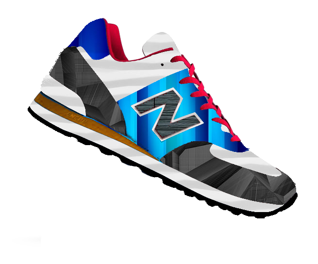
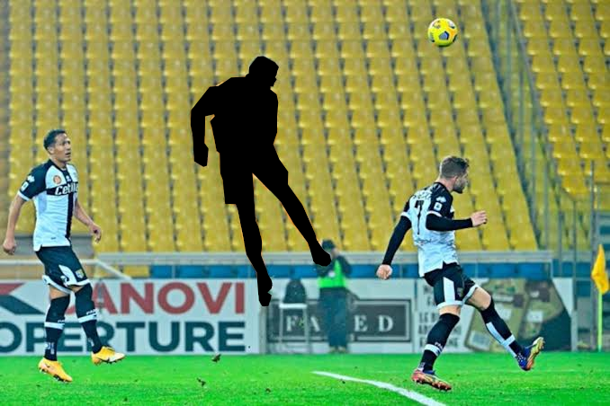
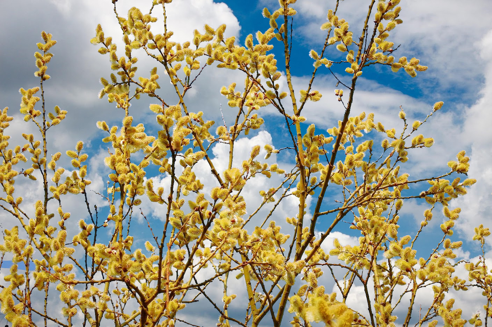

# GIMP

#### Tuneado de zapatilla 

<escape></escape>

Para hacer este trabajo abrí la imagen de la zapatilla en GIMP. Después utilicé las herramientas de selección para marcar las partes que quería modificar sin cambiar el resto de la imagen. Fui cambiando su aspecto y los colores de las zonas seleccionadas para conseguir una zapatilla personalizada. Por último, revisé el resultado y guardé la imagen en formato PNG.

#### Decorar ciudad

<escape></escape>

Para realizar este trabajo abrí la imagen de la calle en GIMP. Utilicé las herramientas de edición para modificar la fotografía y decorar la ciudad con grafitis. Fui ajustando los elementos y su colocación para que quedaran integrados en la imagen. Al terminar, revisé el resultado y guardé el trabajo.
#### Silueta

<escape></escape>

Para hacer esta actividad abrí la imagen en GIMP y utilicé las herramientas de selección para separar la figura del fondo. Después trabajé con los colores para dejar la figura en negro y conseguir el efecto de silueta. Por último, revisé la imagen y guardé el resultado.
#### Retrato en blanco y negro

<escape></escape>

Para realizar esta actividad abrí la fotografía en GIMP. Después utilicé las herramientas de color para pasar la imagen a blanco y negro, quitando los colores y dejando diferentes tonos de gris. Ajusté el resultado para que se vieran bien las partes claras y oscuras de la fotografía. Por último, revisé la imagen y guardé el resultado en formato PNG.
#### Selección por colores: ramas y nubes

<escape></escape>

Para hacer esta actividad abrí la imagen de las ramas y las nubes en GIMP. Utilicé la herramienta de selección por colores para seleccionar las zonas que tenían colores parecidos. Así pude trabajar con las ramas y las nubes por separado, sin tener que seleccionar cada parte a mano. Después ajusté las zonas seleccionadas y revisé el resultado. Por último, guardé la imagen.

