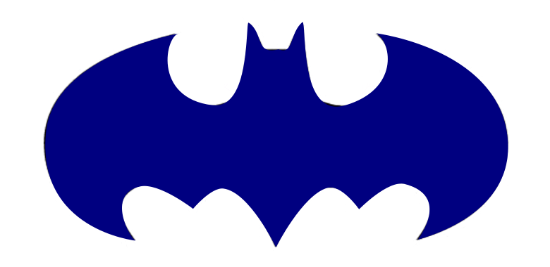

# Inkscape

## Dibujo con Inkscape

<escape></escape>

En esta actividad utilicé Inkscape para realizar un dibujo de Batman. Trabajé con las herramientas de dibujo, las formas y los trazados para crear y modificar las distintas partes de la imagen. También pude ajustar los tamaños y colocar cada elemento en su sitio. Al terminar, guardé el resultado como imagen PNG.

<escape>.svg)</escape>

En este trabajo hice una ilustración de un oso panda utilizando Inkscape. La imagen está formada por vectores, es decir, por líneas y formas que se pueden modificar por separado. Así se puede cambiar el tamaño sin que pierda calidad. Utilicé las herramientas de dibujo y los trazados para crear las diferentes partes del panda y añadí los colores. Finalmente, guardé el proyecto en formato SVG.

## Vectorización con Inkscape

En esta actividad utilicé Inkscape para vectorizar un dibujo. Primero partí de la imagen original y fui creando los trazados para repasar sus líneas y formas. Después trabajé con las zonas negras y blancas para separar las partes del dibujo y conseguir una versión vectorial. Por último, añadí color al diseño y obtuve el resultado final. Al estar vectorizado, el dibujo se puede ampliar sin perder calidad.

