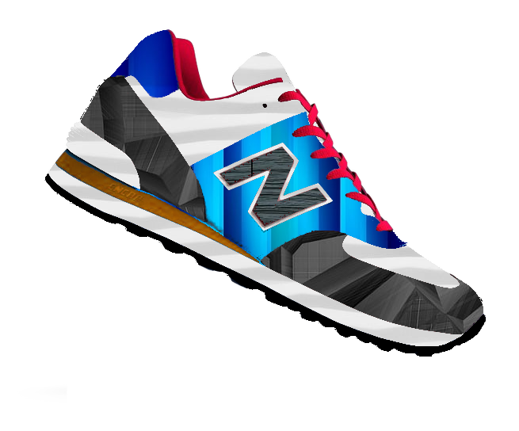
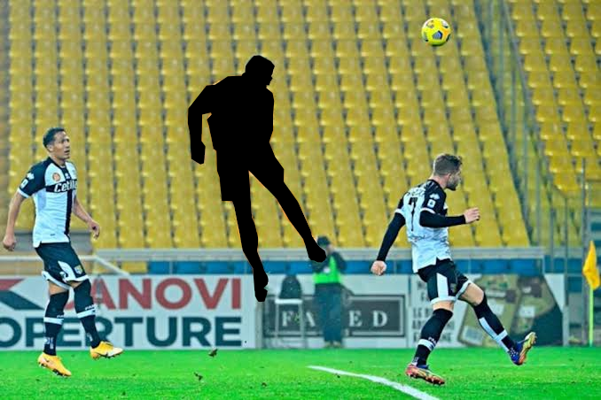

# GIMP

#### Tuneado de zapatilla 

<escape></escape>

Para hacer este trabajo abrí la imagen de la zapatilla en GIMP. Después utilicé las herramientas de selección para marcar las partes que quería modificar sin cambiar el resto de la imagen. Fui cambiando su aspecto y los colores de las zonas seleccionadas para conseguir una zapatilla personalizada. Por último, revisé el resultado y guardé la imagen en formato PNG.

#### Decorar ciudad

<escape></escape>

Para realizar este trabajo abrí la imagen de la calle en GIMP. Utilicé las herramientas de edición para modificar la fotografía y decorar la ciudad con grafitis. Fui ajustando los elementos y su colocación para que quedaran integrados en la imagen. Al terminar, revisé el resultado y guardé el trabajo.
#### Silueta

<escape></escape>

Para hacer esta actividad abrí la imagen en GIMP y utilicé las herramientas de selección para separar la figura del fondo. Después trabajé con los colores para dejar la figura en negro y conseguir el efecto de silueta. Por último, revisé la imagen y guardé el resultado.
#### Retrato en blanco y negro
#### Selección por colores: ramas y nubes

# Inkscape
- Dibujo con Inkscape
- Vectorización con Inkscape
- Proyecto puerta

## Ciudadanía digital crítica
- Fake news
- Encriptación

## Herramientas de Google
- Procesador de textos
- Hojas de cálculo
- Formularios

## Hardware

## Programación

## Lecturas

### Lectura 1. Tus bitcoins son claves

#### ¿Qué son las criptomonedas y cómo funciona Bitcoin?

Las criptomonedas es dinero digital que se puede enviar por internet. Bitcoin es una de las más conocidas y funciona sin depender de un banco para registrar los pagos.

Principalmente se llama **blockchain**.

Para utilizar los bitcoins se necesitan unas **claves privadas**. En algunos monederos se pueden recuperar mediante una frase de 12 palabras.

**1. El hombre que olvidó la contraseña de 7.002 bitcoins**

Stefan recibió 7.002 bitcoins en 2011 como pago por hacer un vídeo sobre Bitcoin. Guardó las claves en un dispositivo USB protegido con contraseña. Perdió el papel donde la había apuntado y no logró recordarla. El dispositivo solo permitía diez intentos y, cuando se conoció su historia, ya había fallado ocho veces.

**2. El hombre que tiró un disco duro con 8.000 bitcoins**

James Howells guardó las claves de sus bitcoins en el disco duro de un ordenador. En 2013, el disco terminó por error en una bolsa de basura que llegó a un vertedero de Gales. Aunque los bitcoins siguen registrados en la blockchain, no puede acceder a ellos sin las claves guardadas en ese disco.

**3. El hombre que perdió 800 bitcoins al formatear un ordenador**

Gabriel Abed tenía las claves de unos 800 bitcoins guardadas en un ordenador. En 2011 pidió que lo formatearan para solucionar unos problemas, pero nadie hizo una copia de seguridad. Al borrar los datos, desaparecieron también las claves y perdió el acceso a sus bitcoins.

**4. El robo de 1,7 millones de dólares al fotografiar una contraseña**

Un ladrón fotografió en secreto el papel donde una persona tenía escrita la frase de recuperación. Después utilizó esa información para acceder a las criptomonedas y robarlas. La frase funcionaba como una llave para entrar en el monedero.

